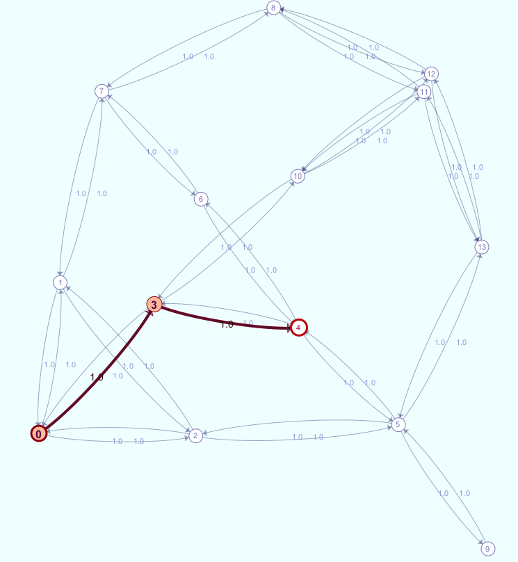

# bb4-shortest-paths

📊 [Build status for all bb4 projects](https://github.com/bb4/.github)

Some shortest path algorithm implementations and visualizations.
 - Dijkstra's algorithm - single-source shortest paths 
 - ModifiedDijkstra's - shortest path between two nodes
 - Yen's algorithm - finds the K shortest paths between two nodes

A GraphViewerApp is also provided. It allows you to view the graph test cases.

## How to use it

Run ./gradlew to build and run the tests.

`./gradlew test` stays on the fast suites. `road_network_01` is tagged slow and runs only when you opt in:

```
./gradlew test -Dshortestpaths.includeSlow=true
```

`./gradlew benchmark` times Dijkstra, Modified Dijkstra, and Yen on the smoke fixtures (`tiny_graph_*`, `sp_4_*`, `sp_10_1`), the medium graphs (`sp_400`, `sp_500`, `sp_700`), and `road_network_01`. It prints a table and rewrites `benchmarks/baseline/baseline.csv`. The task fails if path costs disagree or a golden file does not match. It does not fail because a timing changed. Large cases are timed once, without a warmup run.

The default application is PathViewer. File → Open Graph loads a graph, and the Solve bar runs Dijkstra (all targets), Modified Dijkstra (the chosen source and target only), or Yen (k shortest paths, k from 1 to 10). File → Open Shortest Paths and File → Open K Shortest Paths still open the golden solution files.
For example, here is a shortest path result for sp_120 example. For Dijkstras and ModifiedDijkstras, you can mouse over a node to see the shortest path to that node.


</br></br>
For Yen's and Eppstein's algorithms, you can mouse over nodes or edges to see the shortest paths that pass through that respective node or edge. There is a different color for each of the k-shortest paths found.


Future Features
 - add other variations of Eppsteins algorithm.


